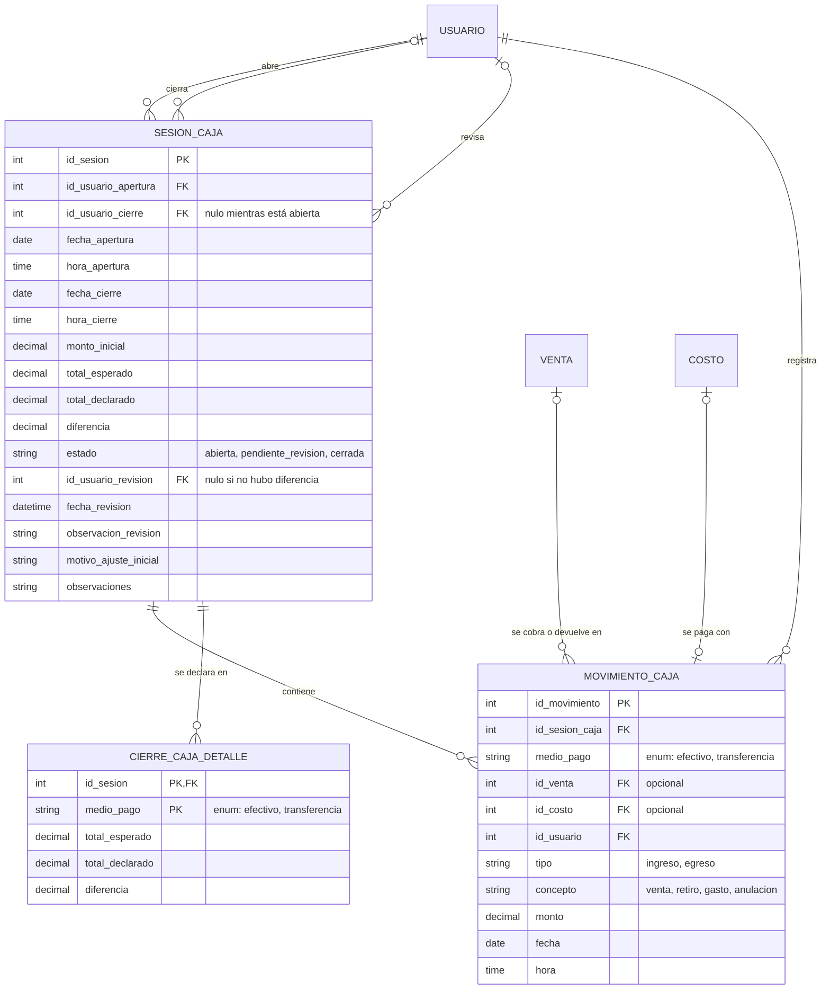

# Módulo Caja: decisiones de la sesión grill-me

Sesión del 3/11/2026. Base: Proyecto-PPS.pdf y diagrama ER del 3/11/2026.

## Decisiones del equipo

1. **Una sola caja compartida.** Nunca hay dos sesiones abiertas a la vez. No hace falta tabla Caja.
2. **Cierra cualquier usuario con permiso**, no necesariamente quien abrió. Sesion_Caja lleva `id_usuario_apertura` e `id_usuario_cierre` (nulo mientras está abierta).
3. **Al cerrar se declara cada medio de pago por separado**: el efectivo se cuenta y las transferencias se controlan contra el banco. Nueva tabla Cierre_Caja_Detalle con esperado, declarado y diferencia por medio. El medio de pago es un enum (efectivo, transferencia), decidido el 4/11.
4. **Egresos de caja: retiros y gastos chicos**, incluidos pagos menores a proveedores. Movimiento_Caja de tipo egreso con concepto. Si es un costo, se vincula con la tabla de costos (FK opcional).
5. **Un cierre ya hecho solo lo corrige un administrador.** Cada cambio queda en Auditoria: usuario, fecha y hora, registro, valor anterior y valor nuevo.
6. **Anular una venta cobrada** la pasa a estado `anulada` y crea un Movimiento_Caja de egreso por el mismo monto en la sesión abierta en ese momento. El movimiento original nunca se borra ni se edita.
7. **No hay cuenta corriente: toda venta se cobra al confirmarla.** Por eso no se puede confirmar una venta sin una sesión de caja abierta.
8. **El "empleado" es lo mismo que un vendedor.** El sistema tiene dos roles: Administrador y Vendedor.

## Respuestas de la clienta (4/11/2026)

9. **Monto inicial:** el sistema sugiere el declarado del cierre anterior. Si quien abre lo cambia, tiene que escribir un motivo (`motivo_ajuste_inicial`).
10. **Pagos mixtos: sí.** `medio_pago` sale de Venta. Una venta confirmada tiene uno o más Movimiento_Caja de ingreso, y la suma de sus montos tiene que dar el total de la venta.
11. **Diferencia en el cierre:** si no es cero, la sesión queda en estado `pendiente_revision` hasta que un administrador la revise. Si es cero, pasa directo a `cerrada`. La revisión guarda quién, cuándo y su observación.

Supuesto nuestro (confirmar con el equipo): una sesión pendiente de revisión ya está cerrada para operar, así que se puede abrir la siguiente.

## Decisiones de domain-modeling (4/11/2026)

12. "Ingreso" y "egreso" a secas son siempre dinero. Las tablas de stock pasan a Ingreso_Mercaderia y Salida_Mercaderia.
13. No hay devoluciones parciales: se anula la venta entera y se carga una nueva con lo que el cliente se queda.

Supuesto (confirmar): al anular una venta, los productos vuelven al stock con un Movimiento_Stock que apunta a la misma venta. Si un producto vuelve dañado, se registra además una incidencia.

## Pendiente de confirmar con la clienta

- ¿Algún cliente grande se lleva mercadería y paga después? El equipo decidió que no.

## Cambios al diagrama del 3/11

| Tabla | Cambio |
| --- | --- |
| Sesion_Caja | `id_usuario` se reemplaza por `id_usuario_apertura` e `id_usuario_cierre` (N) |
| Sesion_Caja | Agregar `monto_inicial` (lo pide el PDF) y `motivo_ajuste_inicial` (N) |
| Sesion_Caja | `total_esperado`, `total_declarado` y `diferencia` pasan a ser la suma del detalle (se pueden guardar o calcular) |
| Cierre_Caja_Detalle (nueva) | `id_sesion` FK + `medio_pago` enum (juntos son la PK), `total_esperado`, `total_declarado`, `diferencia` |
| MedioPago | **Decidido: enum** (efectivo, transferencia). No hay tabla MedioPago: `medio_pago` es columna enum en Movimiento_Caja y en Cierre_Caja_Detalle |
| Movimiento_Caja | `medio_pago` pasa de texto a enum; `id_venta` FK nula (Venta 1 → 0..N Movimiento_Caja); `tipo` = ingreso / egreso; `id_costo` FK opcional |
| Venta | Sacar `medio_pago` (lo tiene cada Movimiento_Caja, pagos mixtos); agregar `estado` (confirmada / anulada) |
| Sesion_Caja | `estado`: abierta / pendiente_revision / cerrada. Agregar `id_usuario_revision` FK (N), `fecha_revision` (N), `observacion_revision` (N) |
| Ingreso / Salida | Se renombran Ingreso_Mercaderia y Salida_Mercaderia (decidido 4/11): "ingreso" y "egreso" a secas quedan para el dinero |
| Usuario | `rol` como FK a una tabla Rol (Administrador, Vendedor) |

Aclarado: la tabla cortada de la página 4 era Movimiento_Caja (tiene además `fecha`, `hora` y `observaciones`). En la versión corregida, `id_usuario_cierre` todavía tiene que marcarse como FK y nula (N), y `id_venta` en Movimiento_Caja como FK.

## Diagrama (Mermaid)

