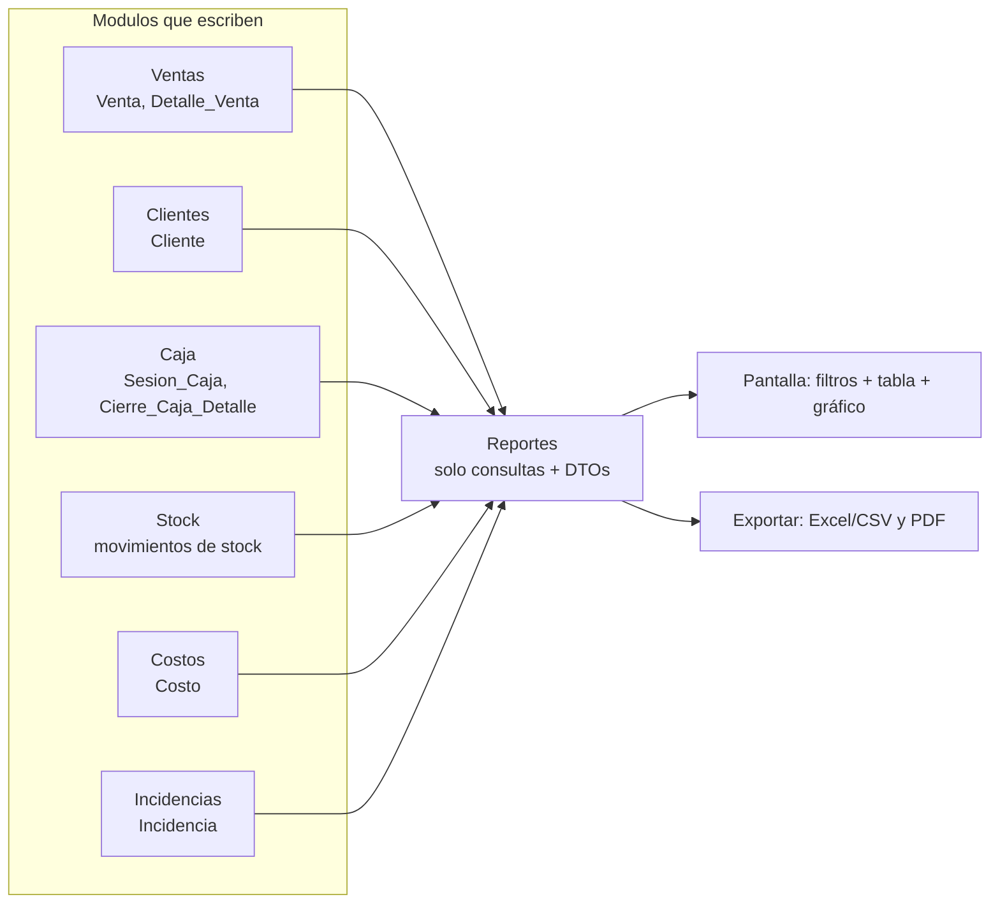

# Módulo Reportes: decisiones

Respuestas del equipo recibidas el 26/11/2026 al cuestionario [11-reportes](preguntas/11-reportes.md). Base: Proyecto-PPS.pdf (secciones 8 y 14), lo decidido en [Caja](caja-decisiones.md) y en [Ventas y Clientes](ventas-clientes-decisiones.md), y el [ADR 0004](docs/adr/0004-reportes-como-consultas-sin-tablas-propias.md).

## Cómo se relaciona Reportes con el resto (la idea en un párrafo)

Reportes es el único módulo que **no guarda nada**: solo **lee**. Cada reporte es una consulta (un `SELECT` con `GROUP BY`) sobre las tablas que llenan los otros módulos: Venta y Detalle_Venta (Ventas), Cliente (Clientes), Sesion_Caja y Cierre_Caja_Detalle (Caja), los movimientos de stock (Stock), Costo (Costos) e Incidencia (Incidencias). El backend arma la respuesta como un **DTO** (un objeto solo para transportar datos: filas, totales y la serie del gráfico) y React la muestra como tabla, gráfico y filtros. Por eso cada reporte **depende** del módulo del que lee: no se puede hacer el reporte de costos antes de que exista la tabla Costo.



## Decisiones

| # | Pregunta | Respuesta | Qué implica |
| --- | --- | --- | --- |
| 1 | ¿Qué reportes primero? | a) Ventas por período y por producto, stock actual y bajo mínimo, y cierres de caja | Esos son los primeros tickets. Los de stock quedan bloqueados hasta que se responda el módulo Stock |
| 2 | ¿Cómo se ven? | a) Tabla con filtros y un gráfico simple (barras o líneas) por reporte | Cada reporte = una pantalla con filtros arriba, gráfico y tabla. Gráficos con Recharts. Sin dashboard en el inicio |
| 3 | ¿Se exportan? | c) A Excel (o CSV) y a PDF | Cada reporte exporta exactamente lo que se ve con los filtros aplicados |
| 4 | Filtros | a) Rango de fechas siempre, y según el reporte: producto, categoría, cliente, tipo de cliente, vendedor | El rango de fechas es obligatorio en todos los reportes de movimientos; los demás filtros son opcionales |
| 5 | Comparación estacional | a) Un mes contra el mismo mes de años anteriores, y líneas superpuestas por año | Agrupar por año y mes; una línea por año con 12 puntos |
| 6 | ¿Qué es "facturación"? | b) Total facturado con factura fiscal, porque **la clienta quiere emitir facturas desde el sistema** | No se puede hacer todavía: el sistema no tiene facturas. Ver "Facturación" abajo |
| 7 | ¿Quién ve los reportes? | b) Solo administradores | Todo el módulo exige rol Administrador, en el backend (no alcanza con ocultar el menú) |
| 8 | ¿Ganancia? | a) Sí, reporte de resultado (ventas − costos), **y además todos los del PDF** | Se agrega el reporte de resultado. Se hacen todos los reportes de las secciones 8 y 14 del PDF |

## Facturación: qué cambió y por qué no se modela acá

En el cuestionario de Ventas (pregunta 15) la opción recomendada era "se factura por fuera del sistema". La respuesta de Reportes 6 dice lo contrario: **la clienta quiere emitir facturas desde el sistema**. **Confirmado por Mayra el 26/11/2026: las facturas las tiene que emitir el sistema.** Queda como funcionalidad a agregar en Ventas. Esto no es un tema de Reportes, es de **Ventas (módulo de Ivan)**, y es grande:

- En Argentina una factura válida es una **factura electrónica de ARCA (ex AFIP)**: hay que pedir un CAE por web service, con certificado digital, punto de venta y tipo de comprobante (A, B o C según la condición frente al IVA del taller y del cliente).
- Eso agrega datos que hoy no existen: condición frente al IVA del cliente, número y tipo de factura, CAE, notas de crédito para anular una venta facturada, etc.
- No está en el PDF del proyecto y afecta el alcance de la PPS.

Por eso **no se inventa ningún modelo de facturación**. Mientras tanto:

- El dato que sí existe es el **total vendido** (suma de ventas confirmadas). Todos los reportes de ventas muestran eso, y se llama así, no "facturación".
- El reporte de **facturación** (REP-14) queda bloqueado hasta que Ventas decida cómo se factura.

Preguntas que hay que llevarle al equipo y a la clienta (van en la lista de abajo): ¿factura electrónica de ARCA o solo un comprobante interno?, ¿el taller es monotributista o responsable inscripto?, ¿se factura toda venta o solo a quien la pide?, ¿entra en el alcance de la PPS o queda como mejora futura?

## Reglas comunes a todos los reportes

Son interpretaciones nuestras sobre lo ya decidido. Si el equipo no está de acuerdo, se corrigen acá.

1. **Ventas anuladas no cuentan.** Solo `estado = confirmada`. Ya estaba visto en el cuestionario.
2. **Se cuenta por la fecha de la venta, con su estado de hoy.** Si una venta de octubre se anula en noviembre, el reporte de ventas de octubre baja. Esto es distinto de la caja: en el cierre de octubre esa plata entró, y la devolución sale en la sesión de noviembre. Por eso **"total vendido" y "cobrado en caja" no siempre coinciden**, y está bien.
3. **Rango de fechas inclusivo:** "del 1/10 al 31/10" incluye todo el 31. En la consulta: `fecha >= desde AND fecha < hasta + 1 día`.
4. **Pesos sí se suman; cantidades solo dentro de la misma unidad.** 3 frascos + 2 kg no da 5 de nada. Los reportes que muestran cantidades agrupan también por unidad de venta (de ahí salen "ventas por unidad" y "ventas por peso" del PDF). **Pendiente en REP-03:** hoy `Producto` no guarda la unidad de venta, así que ese reporte muestra la cantidad por producto sin desglosar unidad/peso; no se infiere de los decimales de `cantidad` porque un kilo entero daría un resultado falso. Ver el pendiente documentado en el ticket.
5. **Los montos ya vienen calculados en la venta.** Se suma `Venta.total` (o `Detalle_Venta.subtotal` cuando se agrupa por producto), nunca se recalcula con el precio actual del catálogo.
6. **Por producto se suma desde las líneas.** Si algún día se aprueba el descuento sobre el total de la venta (Ventas 3), la suma de las líneas va a dar más que `Venta.total`. Mientras ese descuento sea 0 coinciden; cuando se apruebe hay que decidir cómo se reparte (ver preguntas abiertas).
7. **Meses sin datos aparecen en 0**, así los gráficos de evolución no saltan meses. Se completa en Java, no con funciones especiales de Postgres.
8. **SQL estándar.** `GROUP BY`, `SUM`, `COUNT`, `EXTRACT(YEAR/MONTH ...)`, `date_trunc`, que funcionan igual en Postgres 15 y 17. Si una consulta se repite mucho o es lenta, se guarda como **vista SQL** (no materializada). Detalle en el ADR 0004.
9. **Agrupación temporal elegible:** por día, semana o mes, según el largo del rango.
10. **Cliente genérico en REP-04:** `GENERICO` y `CONSUMIDOR_FINAL` se unifican en un solo filtro y una sola barra ("Consumidor final"); en la tabla por cliente el genérico se muestra aparte como "Consumidor final (mostrador)". El resumen se calcula sobre las filas filtradas y siempre incluye los dos tipos, aunque den cero. Decisión de Mayra (27/11/2026).
11. **Exportar** genera el archivo en el backend con la misma consulta y los mismos filtros que la pantalla, así lo exportado nunca difiere de lo que se ve. El nombre del archivo lleva el reporte y el rango (por ejemplo `ventas-por-periodo_2026-10-01_2026-10-31.xlsx`). Propuesta: Apache POI para Excel y OpenPDF para PDF; CSV sin librería.
12. **Vendedor en REP-05:** es el usuario autenticado que registró la venta (`Venta.id_vendedor`, Ventas 10 opción a). No se filtra por rol: los administradores con ventas también aparecen. Se muestran solo quienes tienen ventas confirmadas en el rango, con ticket promedio por fila y en los totales. La etiqueta es `nombre (ROL)` y lleva además el email cuando dos usuarios del reporte comparten nombre (decisión de Mayra, 27/11/2026). El selector incluye inactivos, marcados como tales.

## Lista de reportes y de dónde lee cada uno

| Reporte | Lee de | Filtros además de fechas | Gráfico | Ticket | Estado |
| --- | --- | --- | --- | --- | --- |
| Ventas por período (total vendido, cantidad de ventas, ticket promedio) | Venta | agrupar por día/semana/mes | barras | REP-01 | Listo |
| Ventas por producto, cantidades y más vendidos (sin desglose unidad/peso, pendiente) | Detalle_Venta, Producto | producto, categoría | barras horizontales (top N) | REP-03 | Listo |
| Ventas por cliente y por tipo de cliente | Venta, Cliente | cliente, tipo de cliente | barras | REP-04 | Listo |
| Ventas por vendedor | Venta, Usuario | vendedor | barras | REP-05 | Listo (vendedor = quien registra) |
| Evolución temporal y comparación estacional | Venta | producto, categoría | líneas (una por año) | REP-06 | Listo |
| Cierres de caja | Sesion_Caja, Cierre_Caja_Detalle | usuario, estado, medio de pago | barras de diferencias | REP-07 | Listo |
| Stock actual y bajo mínimo | stock de productos e insumos | categoría, solo bajo mínimo | barras actual vs mínimo | REP-08 | 🔒 Stock |
| Entradas, salidas y descartes de stock | movimientos de stock | producto/insumo, tipo, proveedor | barras apiladas | REP-09 | 🔒 Stock |
| Costos por tipo (insumos, sueldos, servicios) y evolución | Costo | tipo de costo | líneas por tipo | REP-10 | 🔒 Costos |
| Resultado del período (ventas − costos) | Venta, Costo | — | barras vendido vs costos + línea de resultado | REP-11 | 🔒 Costos |
| Producción: productos elaborados y consumo de insumos | registro de producción | producto, insumo | barras | REP-12 | 🔒 Stock pregunta 1 |
| Incidencias y descartes | Incidencia, salidas por descarte | producto, tipo, estado | barras por tipo | REP-13 | 🔒 Incidencias |
| Facturación | (no existe todavía) | — | — | REP-14 | 🔒 Facturación en Ventas |

Más la base técnica común: REP-02 (exportar a Excel/CSV y PDF).

### Fórmulas

```
total vendido        = SUMA(Venta.total)            de ventas confirmadas en el rango
cantidad de ventas   = CONTAR(Venta)                 confirmadas en el rango
ticket promedio      = total vendido / cantidad de ventas      (0 si no hubo ventas)
vendido por producto = SUMA(Detalle_Venta.subtotal)  de líneas de ventas confirmadas
cantidad vendida     = SUMA(Detalle_Venta.cantidad)  agrupada por producto
                       (y por unidad cuando exista Producto.unidad_venta; hoy no existe, ver REP-03)
resultado            = total vendido del período − total de costos del período
```

**Resultado** compara el período de la venta (su fecha) con el período del costo. Cómo se asigna un costo a un período depende de Costos pregunta 4 (mes y año, o fecha de pago). Es un resultado **simple**, no contable: no considera stock sin vender ni amortizaciones. Conviene aclararlo en la pantalla para que nadie lo lea como un balance.

## Ejemplos para entender los casos borde

- **Venta mixta.** Una venta de $10.000 cobrada $6.000 en efectivo y $4.000 por transferencia cuenta **una vez** $10.000 en ventas. En el reporte de cierres de caja aparece repartida por medio de pago. Por eso ventas suma `Venta.total`, y nunca los movimientos de caja.
- **Mostrador.** Las ventas del cliente genérico aparecen en "ventas por cliente" como "Consumidor final (mostrador)", un cliente más (ADR 0003). En "por tipo de cliente" suman en consumidor final junto con los consumidores finales registrados; el filtro "Consumidor final" incluye ambos tipos.
- **Cliente inactivo.** Sus ventas viejas siguen apareciendo con su nombre. En el filtro de cliente se puede elegir aunque esté inactivo.
- **Vendedor inactivo o administrador.** En REP-05 sus ventas siguen contando: la baja lógica no borra el historial y el rol no excluye filas. Se pueden elegir en el filtro y aparecen marcados como inactivos cuando corresponde.
- **Producto que cambió de precio.** Las ventas viejas suman con el precio al que se vendieron (el copiado en la línea).

## Preguntas abiertas

| Pregunta | Para quién | Qué bloquea |
| --- | --- | --- |
| Facturación (ya confirmado que la emite el sistema): ¿factura electrónica de ARCA o comprobante interno? ¿Monotributo o responsable inscripto? ¿Toda venta o solo a pedido? ¿Entra en el alcance de la PPS? **Tiene que decidirlo Ventas (Ivan) y actualizar Ventas 15** | equipo / clienta | REP-14. También cambia Venta y Cliente |
| Stock (todo el cuestionario 06): cómo se guardan stock actual, mínimo y movimientos | equipo | REP-08, REP-09 |
| Stock 1: ¿hay registro de producción? | equipo / clienta | REP-12 |
| Costos (todo el cuestionario 04), sobre todo 4 (período) y 5 (tipos) | equipo / clienta | REP-10, REP-11 |
| Incidencias (cuestionario 09): tipos y estados | equipo | REP-13 |
| Ventas 10: ¿el vendedor puede ser alguien distinto de quien carga la venta? | equipo | REP-05 cambia de columna si es "sí" |
| Ventas 3: si se aprueba el descuento sobre el total, ¿cómo se reparte entre productos en "ventas por producto"? Propuesta: proporcional al subtotal de cada línea | equipo | REP-03 (solo cuando se apruebe) |
| ¿La regla 2 (fecha de la venta con su estado de hoy) les sirve, o quieren ver la anulación en el mes en que se anuló? | equipo | REP-01 y todos los de ventas |

## Cambios al diagrama

Ninguno. Reportes no agrega tablas. Solo puede agregar **vistas SQL** si alguna consulta se repite (por ejemplo `v_ventas_confirmadas` con Venta + Cliente + Usuario), que se crean en las migraciones como cualquier otro objeto de la base.

Sí conviene revisar, para que los reportes sean rápidos cuando haya años de datos, que existan índices en `Venta(fecha)`, `Venta(id_cliente)`, `Detalle_Venta(id_venta)`, `Detalle_Venta(id_producto)` y `Sesion_Caja(fecha_apertura)`.

## Estructura en el código

Carpeta `reportes/` como los otros módulos: un controller por grupo (`ReporteVentasController`, `ReporteCajaController`, ...), servicios de solo lectura (`@Transactional(readOnly = true)`), consultas en repositorios con JPQL o SQL nativo que devuelven DTOs (no entidades), y una clase de exportación común que recibe el DTO y genera Excel, CSV o PDF. Endpoints bajo `/api/reportes/...`, todos con rol Administrador.
