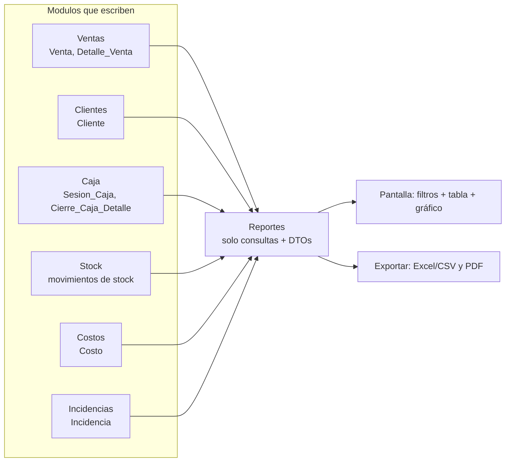

# Módulo Reportes: decisiones

Respuestas del equipo recibidas el 26/11/2026 al cuestionario [11-reportes](preguntas/11-reportes.md). Base: Proyecto-PPS.pdf (secciones 8 y 14), lo decidido en [Caja](caja-decisiones.md) y en [Ventas y Clientes](ventas-clientes-decisiones.md), y el [ADR 0004](docs/adr/0004-reportes-como-consultas-sin-tablas-propias.md).

## Cómo se relaciona Reportes con el resto (la idea en un párrafo)

Reportes es el único módulo que **no guarda nada**: solo **lee**. Cada reporte es una consulta (un `SELECT` con `GROUP BY`) sobre las tablas que llenan los otros módulos: Venta y Detalle_Venta (Ventas), Cliente (Clientes), Sesion_Caja y Cierre_Caja_Detalle (Caja), los movimientos de stock (Stock), Costo (Costos) e Incidencia (Incidencias). El backend arma la respuesta como un **DTO** (un objeto solo para transportar datos: filas, totales y la serie del gráfico) y React la muestra como tabla, gráfico y filtros. Por eso cada reporte **depende** del módulo del que lee: no se puede hacer el reporte de costos antes de que exista la tabla Costo.



## Decisiones

| # | Pregunta | Respuesta | Qué implica |
| --- | --- | --- | --- |
| 1 | ¿Qué reportes primero? | a) Ventas por período y por producto, stock actual y bajo mínimo, y cierres de caja | Esos son los primeros tickets. Stock ya respondió de dónde sale el saldo y el mínimo: REP‑08 y REP‑09 están listos (ver decisiones 15, 16 y 17). Costos respondió el cuestionario 04 (decisión 18) y Mayra confirmó REP‑10 (decisión 19), que quedó implementado |
| 2 | ¿Cómo se ven? | a) Tabla con filtros y un gráfico simple (barras o líneas) por reporte | Cada reporte = una pantalla con filtros arriba, gráfico y tabla. Gráficos con Recharts. Sin dashboard en el inicio |
| 3 | ¿Se exportan? | c) A Excel (o CSV) y a PDF | Cada reporte exporta exactamente lo que se ve con los filtros aplicados |
| 4 | Filtros | a) Rango de fechas siempre, y según el reporte: producto, categoría, cliente, tipo de cliente, vendedor | El rango de fechas es obligatorio en todos los reportes de movimientos; los demás filtros son opcionales |
| 5 | Comparación estacional | a) Un mes contra el mismo mes de años anteriores, y líneas superpuestas por año | Agrupar por año y mes; una línea por año con 12 puntos |
| 6 | ¿Qué es "facturación"? | b) Total facturado con factura fiscal, porque **la clienta quiere emitir facturas desde el sistema** | No se puede hacer todavía: el sistema no tiene facturas. Ver "Facturación" abajo |
| 7 | ¿Quién ve los reportes? | b) Solo administradores | Todo el módulo exige rol Administrador, en el backend (no alcanza con ocultar el menú) |
| 8 | ¿Ganancia? | a) Sí, reporte de resultado (ventas − costos), **y además todos los del PDF** | Se agrega el reporte de resultado. Se hacen todos los reportes de las secciones 8 y 14 del PDF |

## Facturación: qué cambió y por qué no se modela acá

En el cuestionario de Ventas (pregunta 15) la opción recomendada era "se factura por fuera del sistema". La respuesta de Reportes 6 dice lo contrario: **la clienta quiere emitir facturas desde el sistema**. **Confirmado por Mayra el 26/11/2026: las facturas las tiene que emitir el sistema.** Queda como funcionalidad a agregar en Ventas. Esto no es un tema de Reportes, es de **Ventas (módulo de Ivan)**, y es grande:

- En Argentina una factura válida es una **factura electrónica de ARCA (ex AFIP)**: hay que pedir un CAE por web service, con certificado digital, punto de venta y tipo de comprobante (A, B o C según la condición frente al IVA del taller y del cliente).
- Eso agrega datos que hoy no existen: condición frente al IVA del cliente, número y tipo de factura, CAE, notas de crédito para anular una venta facturada, etc.
- No está en el PDF del proyecto y afecta el alcance de la PPS.

Por eso **no se inventa ningún modelo de facturación**. Mientras tanto:

- El dato que sí existe es el **total vendido** (suma de ventas confirmadas). Todos los reportes de ventas muestran eso, y se llama así, no "facturación".
- El reporte de **facturación** (REP-14) queda bloqueado hasta que Ventas decida cómo se factura.

Preguntas que hay que llevarle al equipo y a la clienta (van en la lista de abajo): ¿factura electrónica de ARCA o solo un comprobante interno?, ¿el taller es monotributista o responsable inscripto?, ¿se factura toda venta o solo a quien la pide?, ¿entra en el alcance de la PPS o queda como mejora futura?

## Reglas comunes a todos los reportes

Son interpretaciones nuestras sobre lo ya decidido. Si el equipo no está de acuerdo, se corrigen acá.

1. **Ventas anuladas no cuentan.** Solo `estado = confirmada`. Ya estaba visto en el cuestionario.
2. **Se cuenta por la fecha de la venta, con su estado de hoy.** Si una venta de octubre se anula en noviembre, el reporte de ventas de octubre baja. Esto es distinto de la caja: en el cierre de octubre esa plata entró, y la devolución sale en la sesión de noviembre. Por eso **"total vendido" y "cobrado en caja" no siempre coinciden**, y está bien.
3. **Rango de fechas inclusivo:** "del 1/10 al 31/10" incluye todo el 31. En la consulta: `fecha >= desde AND fecha < hasta + 1 día`.
4. **Pesos sí se suman; cantidades solo dentro de la misma unidad.** 3 frascos + 2 kg no da 5 de nada. Los reportes que muestran cantidades agrupan también por unidad de venta (de ahí salen "ventas por unidad" y "ventas por peso" del PDF). **Pendiente en REP-03:** hoy `Producto` no guarda la unidad de venta, así que ese reporte muestra la cantidad por producto sin desglosar unidad/peso; no se infiere de los decimales de `cantidad` porque un kilo entero daría un resultado falso. Ver el pendiente documentado en el ticket.
5. **Los montos ya vienen calculados en la venta.** Se suma `Venta.total` (o `Detalle_Venta.subtotal` cuando se agrupa por producto), nunca se recalcula con el precio actual del catálogo.
6. **Por producto se suma desde las líneas.** Si algún día se aprueba el descuento sobre el total de la venta (Ventas 3), la suma de las líneas va a dar más que `Venta.total`. Mientras ese descuento sea 0 coinciden; cuando se apruebe hay que decidir cómo se reparte (ver preguntas abiertas).
7. **Meses sin datos aparecen en 0**, así los gráficos de evolución no saltan meses. Se completa en Java, no con funciones especiales de Postgres.
8. **SQL estándar.** `GROUP BY`, `SUM`, `COUNT`, `EXTRACT(YEAR/MONTH ...)`, `date_trunc`, que funcionan igual en Postgres 15 y 17. Si una consulta se repite mucho o es lenta, se guarda como **vista SQL** (no materializada). Detalle en el ADR 0004.
9. **Agrupación temporal elegible:** por día, semana o mes, según el largo del rango.
10. **Cliente genérico en REP-04:** `GENERICO` y `CONSUMIDOR_FINAL` se unifican en un solo filtro y una sola barra ("Consumidor final"); en la tabla por cliente el genérico se muestra aparte como "Consumidor final (mostrador)". El resumen se calcula sobre las filas filtradas y siempre incluye los dos tipos, aunque den cero. Decisión de Mayra (27/11/2026).
11. **Exportar** genera el archivo en el backend con la misma consulta y los mismos filtros que la pantalla, así lo exportado nunca difiere de lo que se ve. El nombre del archivo lleva el reporte y el rango (por ejemplo `ventas-por-periodo_2026-10-01_2026-10-31.xlsx`). Propuesta: Apache POI para Excel y OpenPDF para PDF; CSV sin librería.
12. **Vendedor en REP-05:** es el usuario autenticado que registró la venta (`Venta.id_vendedor`, Ventas 10 opción a). No se filtra por rol: los administradores con ventas también aparecen. Se muestran solo quienes tienen ventas confirmadas en el rango, con ticket promedio por fila y en los totales. La etiqueta es `nombre (ROL)` y lleva además el email cuando dos usuarios del reporte comparten nombre (decisión de Mayra, 27/11/2026). El selector incluye inactivos, marcados como tales.
13. **Comparación estacional en REP-06:** se comparan el año actual y los dos anteriores por omisión; se pueden elegir de 1 a 5 años, sin repetir, entre 2000 y el año actual (el backend valida y devuelve los años ordenados de menor a mayor). Agrupa con `EXTRACT(YEAR/MONTH)` sobre ventas confirmadas. Sin filtro de producto se suma `Venta.total`; con producto o categoría se suma `Detalle_Venta.subtotal` de las líneas que cumplen, igual que en REP‑03 (la categoría es `Producto.categoria`). Cada año se compara contra el inmediatamente anterior de los seleccionados: `variación = (actual - anterior) / anterior * 100`, con dos decimales; si el anterior vendió 0 se muestra `—` en vez de dividir por cero. Los meses sin ventas se completan en 0 y los meses futuros del año en curso se omiten de la tabla y del gráfico. "Hoy" se toma con un `Clock` en `America/Argentina/Buenos_Aires` (inyectable en tests), la misma zona que usa la pantalla. La exportación reutiliza REP‑02 con el id `evolucion-ventas` y el nombre `evolucion-ventas_<desde>_<hasta>.<ext>`. Decisión de Mayra (27/11/2026).
14. **Cierres de caja en REP-07:** el período se filtra por `Sesion_Caja.fecha_apertura` (inclusivo, `fecha >= desde AND fecha < hasta + 1 día`) y solo se incluyen `CERRADA` y `PENDIENTE_REVISION`; las `ABIERTA` se excluyen por no tener cierre ni declarado. Esperado, declarado y diferencia son los valores vigentes guardados en `Cierre_Caja_Detalle`, con `diferencia = declarado - esperado` a dos decimales. Ingresos y egresos se suman desde `Movimiento_Caja` por `tipo` y `medio_pago`; las anulaciones están registradas como `EGRESO`/`ANULACION` (ADR 0002), por lo que cuentan como egreso y no se filtra por `Venta.estado`. El monto inicial no es ingreso ni egreso. Faltante = diferencia negativa en valor absoluto; sobrante = diferencia positiva; se totalizan por separado, sin netear. El filtro de usuario es por quien cerró (`id_usuario_cierre`) y su selector incluye inactivos. El filtro de medio de pago acota columnas y totales, sin eliminar sesiones. La exportación usa REP‑02 con id `cierres-caja` y nombre `cierres-caja_<desde>_<hasta>.<ext>`, con tabla y fila de totales pero sin gráfico. Las sesiones pendientes se resaltan en tabla y gráfico. **Pendiente:** la marca de "corregido" espera a CAJA‑08; hoy se muestra el valor vigente y no se infiere corrección desde Auditoría. Decisión de Mayra (27/11/2026).
15. **Stock actual y bajo mínimo en REP-08:** es una foto de hoy, sin rango de fechas; el día se toma del `Clock` del taller (`America/Argentina/Buenos_Aires`, inyectable en tests). El saldo es la columna `stock_actual` de `Producto`/`Insumo` con `COALESCE(..., 0)`, **no** la suma de `Movimiento_Stock`: `StockService` es el único escritor, los movimientos son inmutables y no hay reconciliación entre saldo y movimientos. `Insumo.stock_minimo` es obligatorio en el modelo, pero si llegara `null` se usa `0`, igual que `StockService`; "bajo mínimo" es `stock < mínimo` estricto. `Producto` no tiene mínimo ni unidad: se muestra `—`/N/A, nunca se marca como "bajo mínimo" y queda pendiente hasta que Catálogo agregue `stock_minimo` y `unidad_venta` (igual que en REP‑03). Los insumos no tienen categoría: con "Todas" se muestran con `—`; al elegir categoría se filtran solo productos y se ocultan los insumos, con aviso en pantalla. "Falta para el mínimo" es `max(mínimo − stock, 0)`: `0` si no falta y `—` si el mínimo es N/A. La tabla lleva tipo y categoría, se ordena por tipo y nombre, y el gráfico solo muestra los bajo mínimo ordenados por mayor falta; no se suman cantidades de unidades distintas. La exportación reutiliza REP‑02 con id `stock-actual`: como el contrato exige `desde()`/`hasta()`, ambos son hoy y el nombre es `stock-actual_<hoy>_<hoy>.<ext>`; "Foto al …" se agrega en la descripción de filtros sin tocar el contrato compartido. La fila de totales no suma stocks: solo cuenta artículos; los N/A numéricos salen vacíos en el archivo. Decisión de Mayra (27/11/2026).
16. **Detalle de `Movimiento_Stock` para REP‑09 (respuesta de Stock, revisión solo lectura 27/11/2026):** la tabla tiene `tipo` ∈ `ENTRADA`/`SALIDA`, `cantidad` positiva con 3 decimales, `motivo` ∈ `INICIAL`/`COMPRA`/`AJUSTE`/`MERMA`/`DEVOLUCION`, `fecha_hora` (`LocalDateTime` sin zona, escrita con `LocalDateTime.now()` en el servidor), `observaciones`, exactamente uno de `id_producto`/`id_insumo`, `id_usuario`, `id_venta` (nullable) e `id_ingreso_mercaderia` (nullable, reservado para `CST-06`). Los movimientos son inmutables: no hay estado ni anulación; las correcciones son nuevos movimientos. `INICIAL` se genera al dar de alta un artículo con stock. **No hay motivo `VENTA`**: la única marca es la FK `id_venta`, reservada para `VEN-10` (hoy pendiente), y hoy solo aparece en las `ENTRADA`/`DEVOLUCION` que CAJA‑07 genera al anular una venta; por eso hoy no hay salidas por venta que reportar. `StockService` no valida combinaciones `tipo`/`motivo`, así que existen `SALIDA/COMPRA`, `SALIDA/DEVOLUCION`, etc. `Movimiento_Stock` **no guarda proveedor**: la relación es `Proveedor_Insumo` (proveedor ↔ insumo, vigente, y un insumo puede tener varios); los productos no tienen proveedor. Las 7 decisiones que faltaban fueron confirmadas por Mayra el 27/11/2026 y se aplican en la decisión 17. No se modificó Stock ni Catálogo.

17. **Movimientos de stock en REP‑09:** (1) `entradas` = todas las `ENTRADA`, incluida `INICIAL`; `salidasVenta` = `SALIDA` con `id_venta` (esa marca tiene prioridad sobre el motivo, y hoy da 0 hasta que VEN‑10 descuente stock); `descartes` = `SALIDA`/`MERMA`; `ajustes` = `SALIDA`/`AJUSTE`; la 5.ª columna `otrasSalidas` = el resto de `SALIDA` (por ejemplo `COMPRA` o `DEVOLUCION`). (2) `INICIAL` cuenta como entrada, porque es el saldo que se cargó al alta. (3) El filtro "tipo de movimiento" es `ENTRADA`/`SALIDA`, no el motivo: los motivos solo clasifican columnas. (4) El filtro de artículo es un selector combinado con productos e insumos rotulados; el tipo viaja junto al id (no se mezclan ids iguales), hay una fila por artículo y los productos muestran unidad `—`. (5) El proveedor se resuelve por `Proveedor_Insumo` (relación vigente, solo insumos): al elegir uno se ocultan los productos con aviso, se listan solo sus insumos y un `EXISTS` evita duplicar movimientos de insumos con varios proveedores; la tabla no lleva columna de proveedor. (6) El gráfico de barras apiladas tiene una barra por artículo y las 5 series se apilan **dentro** de ese artículo, así nunca se mezclan unidades; los totales solo cuentan artículos y movimientos, sin sumar cantidades. (7) El rango es obligatorio sobre `fecha_hora` como fechas de calendario (`>= desde 00:00` y `< hasta + 1 día`, sin conversión de zona); la exportación reutiliza REP‑02 con id `movimientos-stock`, nombre `movimientos-stock_<desde>_<hasta>.<ext>`, tabla sin gráfico y el aviso de que las salidas por venta aparecerán con VEN‑10. La pantalla muestra el mismo aviso. Decisión de Mayra (27/11/2026).

18. **Respuesta de Costos recibida para REP‑10 (revisión solo lectura 27/11/2026):** el equipo confirmó en [04-costos-res.md](../tickets/costos/04-costos-res.md) que un costo es todo gasto con monto, fecha, período y tipo (Q1); el período es `periodo_mes` + `periodo_anio` además de `fecha_pago`, lo elige quien carga y el servidor lo copia sin derivarlo (Q4, implementado); los tipos son una tabla administrable, no un enum, con `Insumos` reservado y sembrado por el sistema (Q5, implementado); la evolución de insumos debe salir del costo unitario de cada ingreso (Q7, **sin implementar**: `CST-06` sigue bloqueado); y Costos es solo de administradores (Q8). Los costos anulados no cuentan en el total y solo se listan con `incluirAnulados=true`.

19. **Decisiones de Mayra para REP‑10 (confirmó las 7 recomendaciones, 27/11/2026):** (1) rango obligatorio `YYYY-MM` a `YYYY-MM`, inclusivo, sobre `periodo_anio`/`periodo_mes`; años 2000–2100, tope 36 meses y `fecha_pago` no interviene. (2) Anulados excluidos siempre. (3) Selector con activos, inactivos con costos en el rango y el reservado `Insumos`; con "Todos" se tabulan los tipos con costos en el rango más `Insumos`, y con un tipo elegido se muestra solo ese (aunque dé 0). (4) `Insumos` en 0 con aviso de `CST-06`. (5) Meses en filas, tipos en columnas y columna/fila `Total`. (6) Una línea por tipo sobre los mismos meses de la tabla. (7) Exportación REP‑02 con id `costos-por-tipo`, archivo `costos-por-tipo_<desde>_<hasta>.<ext>` y tabla con totales sin gráfico. Solo administradores se hereda de `/api/reportes/**`. REP‑10 quedó implementado sin tocar el módulo Costos.

20. **Decisiones de Mayra para REP‑11 (confirmó las 7 recomendaciones, 27/11/2026):** (1) rango `YYYY-MM` a `YYYY-MM` obligatorio e inclusivo, con tope de 36 meses y años 2000–2100; las ventas se agrupan por su fecha de venta (REP‑01, agrupación `MES`, solo confirmadas) y los costos por `periodo_anio`/`periodo_mes` (REP‑10, anulados excluidos, sin `fecha_pago`). (2) No hay filtro de tipo de costo: entran todos los tipos. (3) La tabla incluye todos los meses del rango, con 0 en los que no hay ventas o costos. (4) El resultado puede ser negativo: se muestra con signo y en rojo, sin recortarlo a 0. (5) Columnas `Período | Total vendido | Total costos | Resultado` más fila `Totales`; el gráfico combinado usa las mismas barras de vendido y costos y una línea de resultado sobre el mismo eje y meses. (6) La pantalla aclara que es un resultado simple, no un balance contable (no considera stock sin vender ni amortizaciones), y repite el aviso de que la evolución real de `Insumos` espera a `CST-06`. (7) Exportación REP‑02 con id `resultado-periodo`, archivo `resultado-periodo_<desde>_<hasta>.<ext>` y tabla sin gráfico. Solo administradores se hereda de `/api/reportes/**`. El servicio cruza los DTOs de REP‑01 y REP‑10: no consulta Venta ni Costo por su cuenta y no tocó esos módulos ni Stock.

## Lista de reportes y de dónde lee cada uno

| Reporte | Lee de | Filtros además de fechas | Gráfico | Ticket | Estado |
| --- | --- | --- | --- | --- | --- |
| Ventas por período (total vendido, cantidad de ventas, ticket promedio) | Venta | agrupar por día/semana/mes | barras | REP-01 | Listo |
| Ventas por producto, cantidades y más vendidos (sin desglose unidad/peso, pendiente) | Detalle_Venta, Producto | producto, categoría | barras horizontales (top N) | REP-03 | Listo |
| Ventas por cliente y por tipo de cliente | Venta, Cliente | cliente, tipo de cliente | barras | REP-04 | Listo |
| Ventas por vendedor | Venta, Usuario | vendedor | barras | REP-05 | Listo (vendedor = quien registra) |
| Evolución temporal y comparación estacional | Venta, Detalle_Venta, Producto | años, producto, categoría | líneas (una por año) | REP-06 | Listo |
| Cierres de caja | Sesion_Caja, Cierre_Caja_Detalle, Movimiento_Caja, Usuario | usuario que cerró, estado, medio de pago | barras de faltantes y sobrantes | REP-07 | Listo |
| Stock actual y bajo mínimo | Producto, Insumo | tipo, categoría, solo bajo mínimo | barras actual vs mínimo | REP-08 | Listo |
| Entradas, salidas y descartes de stock | Movimiento_Stock, Producto, Insumo, Proveedor_Insumo | artículo (producto/insumo), tipo de movimiento, proveedor | barras apiladas por artículo | REP-09 | Listo |
| Costos por tipo y evolución | Costo, TipoCosto | rango `YYYY-MM` obligatorio, tipo de costo | líneas por tipo | REP-10 | Listo |
| Resultado del período (ventas − costos) | Venta, Costo (vía REP‑01 y REP‑10) | rango `YYYY-MM` obligatorio, sin tipo de costo | barras vendido vs costos + línea de resultado | REP-11 | Listo |
| Producción: productos elaborados y consumo de insumos | registro de producción | producto, insumo | barras | REP-12 | 🔒 Stock pregunta 1 |
| Incidencias y descartes | Incidencia, salidas por descarte | producto, tipo, estado | barras por tipo | REP-13 | 🔒 Incidencias |
| Facturación | (no existe todavía) | — | — | REP-14 | 🔒 Facturación en Ventas |

Más la base técnica común: REP-02 (exportar a Excel/CSV y PDF).

### Fórmulas

```
total vendido        = SUMA(Venta.total)            de ventas confirmadas en el rango
cantidad de ventas   = CONTAR(Venta)                 confirmadas en el rango
ticket promedio      = total vendido / cantidad de ventas      (0 si no hubo ventas)
vendido por producto = SUMA(Detalle_Venta.subtotal)  de líneas de ventas confirmadas
cantidad vendida     = SUMA(Detalle_Venta.cantidad)  agrupada por producto
                       (y por unidad cuando exista Producto.unidad_venta; hoy no existe, ver REP-03)
resultado            = total vendido del período − total de costos del período
costo por mes/tipo   = SUMA(Costo.monto) por periodo_anio/periodo_mes y tipo,
                       excluyendo anulados (meses sin costos = 0)
diferencia de cierre = declarado − esperado        (Cierre_Caja_Detalle)
faltante             = |diferencia| si diferencia < 0, si no 0
sobrante             = diferencia si diferencia > 0, si no 0
ingresos / egresos   = SUMA(Movimiento_Caja.monto) por tipo y medio de pago
                       (las ANULACION son EGRESO; el monto inicial no cuenta)
stock actual         = COALESCE(Producto/Insumo.stock_actual, 0)   (columna, foto de hoy)
stock mínimo         = Insumo.stock_minimo, o 0 si llegara null; N/A en productos
bajo mínimo          = stock actual < stock mínimo                 (estricto; nunca en productos)
falta para el mínimo = MAX(stock mínimo − stock actual, 0)         (N/A si el mínimo es N/A)
movimientos          = Movimiento_Stock por fecha_hora, tipo, motivo, id_venta y artículo
entradas             = Movimiento_Stock con tipo ENTRADA (incluye motivo INICIAL)
salida por venta     = SALIDA con id_venta (VEN-10 pendiente: hoy no hay; prioriza sobre motivo)
descartes / ajustes  = SALIDA sin id_venta con motivo MERMA / AJUSTE
otras salidas        = SALIDA sin id_venta con motivo distinto de MERMA / AJUSTE
proveedor            = Proveedor_Insumo del insumo (el movimiento no guarda proveedor)
```

**Resultado** compara el período de la venta (su fecha) con el período del costo: la pregunta 4 de Costos quedó respondida en [04-costos-res.md](../tickets/costos/04-costos-res.md) e implementada con `periodo_mes` y `periodo_anio` además de `fecha_pago` (`Costo.java:34-41`, `CostoService.java:51-77`). REP‑10 ya decidió el rango en meses (`YYYY-MM`) sobre `periodo_anio`/`periodo_mes`, sin `fecha_pago` (decisión 19); REP‑11 usa la misma convención para que los números coincidan (decisión 20). Es un resultado **simple**, no contable: no considera stock sin vender ni amortizaciones. La pantalla lo aclara para que nadie lo lea como un balance.

## Ejemplos para entender los casos borde

- **Venta mixta.** Una venta de $10.000 cobrada $6.000 en efectivo y $4.000 por transferencia cuenta **una vez** $10.000 en ventas. En el reporte de cierres de caja aparece repartida por medio de pago. Por eso ventas suma `Venta.total`, y nunca los movimientos de caja.
- **Mostrador.** Las ventas del cliente genérico aparecen en "ventas por cliente" como "Consumidor final (mostrador)", un cliente más (ADR 0003). En "por tipo de cliente" suman en consumidor final junto con los consumidores finales registrados; el filtro "Consumidor final" incluye ambos tipos.
- **Cliente inactivo.** Sus ventas viejas siguen apareciendo con su nombre. En el filtro de cliente se puede elegir aunque esté inactivo.
- **Vendedor inactivo o administrador.** En REP-05 sus ventas siguen contando: la baja lógica no borra el historial y el rol no excluye filas. Se pueden elegir en el filtro y aparecen marcados como inactivos cuando corresponde.
- **Producto que cambió de precio.** Las ventas viejas suman con el precio al que se vendieron (el copiado en la línea).
- **Cierre con diferencia y anulación posterior.** Si al cerrar faltaban $10 y después se anuló una venta, el egreso de la anulación se suma en la sesión en que se registró (ADR 0002) y no cambia el declarado de la sesión cerrada. En REP‑07 el faltante sigue siendo los $10 del cierre y la anulación aparece como egreso. La marca de "corregido" queda pendiente hasta CAJA‑08; no se deduce de Auditoría.
- **Producto sin mínimo.** Un producto con `stock_actual = 0` no es "bajo mínimo": `Producto` no guarda mínimo, así que mínimo, unidad y falta se muestran `—`. No se inventa un mínimo 0 ni se infiere de los movimientos; queda pendiente hasta que Catálogo agregue los campos (igual que `unidad_venta` en REP‑03).
- **Insumo sin mínimo cargado.** Aunque la columna es obligatoria, el código tolera `null` y lo trata como `0`, igual que `StockService`: con stock `0` o mayor no se marca como bajo mínimo y la falta es `0`. Un insumo con mínimo `0` tampoco se marca salvo stock negativo.
- **Insumo con stock 2 kg y mínimo 5 kg.** Está bajo mínimo, la falta es `3 kg` y el gráfico lo muestra con barras de 2 y 5. Si se elige la categoría "Bebidas", ese insumo desaparece (no tiene categoría) y la pantalla lo avisa.
- **Salida por venta en REP‑09.** Hoy no existe: `VEN‑10` todavía no descuenta stock al confirmar y `id_venta` solo aparece en las devoluciones por anulación (`ENTRADA`/`DEVOLUCION`). La columna "salidas por venta" dará 0 hasta que se implemente `VEN‑10`; no se infiere una venta desde `observaciones` ni desde el motivo.
- **Proveedor en REP‑09.** `Movimiento_Stock` no sabe qué proveedor entregó una entrada: solo se puede filtrar por los proveedores **vigentes** del insumo en `Proveedor_Insumo`. Un producto no tiene proveedor y un insumo puede tener varios; no se suma una misma entrada dos veces si el insumo está asignado a más de un proveedor.
- **Costo con fecha de pago fuera del período.** Un costo de octubre se puede pagar en noviembre: las dos fechas existen y no se valida que coincidan (`Costo.java:34-41`). REP‑10 agrupa por `periodo_mes`/`periodo_anio` (decisión 19, coincide con el reporte del PDF y con los filtros actuales de Costos); `fecha_pago` no interviene, y REP‑11 hace lo mismo (decisión 20).
- **Costo de insumos en REP‑10.** La decisión original dice que la evolución sale del costo unitario de cada ingreso de mercadería, pero `CST-06` sigue bloqueado y `CostoService` prohíbe cargar costos con el tipo reservado `Insumos` a mano (`CostoService.java:100-111`). Mientras tanto, REP‑10 muestra esa serie en 0 con un aviso en pantalla y en el encabezado del archivo (decisión 19); no se infiere desde `Insumo.costo`, `Movimiento_Stock` ni Auditoría porque ninguno guarda el precio por ingreso y mes.

## Preguntas abiertas

| Pregunta | Para quién | Qué bloquea |
| --- | --- | --- |
| Facturación (ya confirmado que la emite el sistema): ¿factura electrónica de ARCA o comprobante interno? ¿Monotributo o responsable inscripto? ¿Toda venta o solo a pedido? ¿Entra en el alcance de la PPS? **Tiene que decidirlo Ventas (Ivan) y actualizar Ventas 15** | equipo / clienta | REP-14. También cambia Venta y Cliente |
| ~~Stock: detalle de movimientos (tipos, motivos y proveedor)~~ **Respondido por Stock el 27/11/2026 (decisión 16) y decidido por Mayra el 27/11/2026 (decisión 17)**: clasificación de columnas, `INICIAL` como entrada, filtro `ENTRADA`/`SALIDA`, selector combinado de artículo, proveedor por `Proveedor_Insumo`, agregación por unidad y exportación con rango de fechas | equipo / Mayra | Ninguna: REP-09 listo |
| Stock 1: ¿hay registro de producción? | equipo / clienta | REP-12 |
| ~~Costos (todo el cuestionario 04), sobre todo 4 (período) y 5 (tipos)~~ **Respondido por el equipo de Costos 27/11/2026 ([04-costos-res.md](../tickets/costos/04-costos-res.md), decisión 18) y decidido por Mayra el 27/11/2026 (decisiones 19 y 20); REP‑10 y REP‑11 listos** | equipo / Mayra | Ninguna para REP-10 ni REP-11 |
| Incidencias (cuestionario 09): tipos y estados | equipo | REP-13 |
| Ventas 10: ¿el vendedor puede ser alguien distinto de quien carga la venta? | equipo | REP-05 cambia de columna si es "sí" |
| Ventas 3: si se aprueba el descuento sobre el total, ¿cómo se reparte entre productos en "ventas por producto"? Propuesta: proporcional al subtotal de cada línea | equipo | REP-03 (solo cuando se apruebe) |
| ¿La regla 2 (fecha de la venta con su estado de hoy) les sirve, o quieren ver la anulación en el mes en que se anuló? | equipo | REP-01 y todos los de ventas |

## Cambios al diagrama

Ninguno. Reportes no agrega tablas. Solo puede agregar **vistas SQL** si alguna consulta se repite (por ejemplo `v_ventas_confirmadas` con Venta + Cliente + Usuario), que se crean en las migraciones como cualquier otro objeto de la base.

Sí conviene revisar, para que los reportes sean rápidos cuando haya años de datos, que existan índices en `Venta(fecha)`, `Venta(id_cliente)`, `Detalle_Venta(id_venta)`, `Detalle_Venta(id_producto)` y `Sesion_Caja(fecha_apertura)`.

## Estructura en el código

Carpeta `reportes/` como los otros módulos: un controller por grupo (`ReporteVentasController`, `ReporteCajaController`, ...), servicios de solo lectura (`@Transactional(readOnly = true)`), consultas en repositorios con JPQL o SQL nativo que devuelven DTOs (no entidades), y una clase de exportación común que recibe el DTO y genera Excel, CSV o PDF. Endpoints bajo `/api/reportes/...`, todos con rol Administrador.
