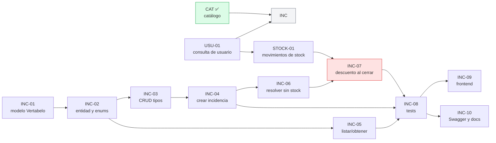

# Backlog — Módulo Incidencias

Tickets necesarios para implementar el módulo `incidencias` según las respuestas de
[`preguntas.md`](preguntas.md).

Leyenda de estado: ✅ Hecho · 🟡 En curso / En definición · 🟢 Listo · 🔴 Bloqueado.

## Mapa de dependencias

> `INC-07` es el único ticket de incidencias bloqueado por `stock`. El resto se puede
> implementar antes, pero la funcionalidad de la pregunta 4 no queda completa hasta cerrarlo.

## Orden recomendado

1. **En paralelo:** `DB-01` (opcional pero recomendado) y `USU-01`.
2. `INC-01` (confirmar la tabla de tipos y actualizar Vertabelo).
3. `INC-02`.
4. **En paralelo:** `INC-03`, `INC-05` y `STOCK-01`.
5. `INC-04`.
6. `INC-06`.
7. `INC-07`.
8. `INC-08`, `INC-09` y `INC-10`.

**Camino crítico:** `USU-01 → INC-02 → INC-03 → INC-04 → INC-06 → INC-07 (necesita STOCK-01) → INC-08`.

---

## Prerrequisitos de otros módulos

### DB-01 — Adoptar Flyway y baseline del esquema

| Campo | Valor |
|---|---|
| Estado | 🟢 Listo |
| Bloqueada por | — |
| Bloquea | Cambios de esquema de `INC-02` (recomendado) |
| Etiquetas | `db`, `infra` |

**Objetivo:** dejar de depender de `ddl-auto=update` para evolucionar el esquema.

**Alcance:**
- Crear `backend/src/main/resources/db/migration/` con una migración baseline que refleje el esquema actual.
- Activar Flyway y usar `ddl-auto=validate` al menos en un perfil de producción.
- Documentar el flujo en `docs/db/README.md`.

**Criterios de aceptación:**
- [ ] `./mvnw test` pasa con Flyway activo.
- [ ] La baseline crea las tablas actuales sin diferencias.
- [ ] Queda documentado cómo agregar una migración nueva.

**Nota:** se puede postergar si el equipo sigue usando `ddl-auto=update` en desarrollo, pero cualquier cambio de esquema de incidencias debería quedar versionado.

---

### USU-01 — Consulta de usuario para otros módulos

| Campo | Valor |
|---|---|
| Estado | 🟢 Listo |
| Bloqueada por | — |
| Bloquea | `INC-02`, `INC-04`, `INC-06`, `STOCK-01`, `VENTA` |
| Etiquetas | `usuario`, `backend` |

**Objetivo:** que otros módulos puedan validar y asociar un usuario sin acceder a su repositorio.

**Alcance:**
- `UsuarioService.obtenerPorId(Long id_usuario)` que devuelva la entidad o lance `RecursoNoEncontradoException`.
- `UsuarioResponseDTO` con `id_usuario`, `nombre`, `email` y `rol` (sin password).
- `GET /api/usuarios/{id_usuario}`.
- Test de 404 para un ID inexistente.

**Criterios de aceptación:**
- [ ] `GET /api/usuarios/{id_usuario}` devuelve 200 o 404 con el formato de error de `common`.
- [ ] La respuesta nunca incluye `password`.
- [ ] Otros módulos pueden inyectar `UsuarioService` sin tocar `UsuarioRepository`.

---

### STOCK-01 — Movimiento de stock y ajuste

> **Nota:** el alcance y el estado de este ticket se gestionan ahora en
> [`../stock/backlog.md`](../stock/backlog.md#stock-01--modelo-y-entidad-movimiento_stock).
> Esta sección queda como registro histórico del relevamiento de incidencias.

| Campo | Valor |
|---|---|
| Estado | 🔴 Bloqueado por `USU-01` |
| Bloqueada por | `USU-01` |
| Bloquea | `INC-07`, `VENTA`, `PEDIDOS`, `COSTOS`, `REPORTES` |
| Etiquetas | `stock`, `backend`, `db` |

**Objetivo:** tener un único punto para modificar `stock_actual`, con trazabilidad.

**Alcance:**
- Entidad de movimiento (`Movimiento_Stock` según Vertabelo) con producto o insumo, tipo, cantidad, motivo, usuario y fecha.
- Servicio que registre el movimiento y actualice el stock en la **misma transacción**.
- Validación de stock suficiente: si no alcanza, `409` y sin cambios.
- Tests de entrada, salida y stock insuficiente.

**Criterios de aceptación:**
- [ ] Ningún módulo actualiza `stock_actual` directamente: todos pasan por este servicio.
- [ ] Cada movimiento queda registrado con usuario y fecha.
- [ ] Un intento de dejar stock negativo devuelve 409 y hace rollback.
- [ ] Nombres de tabla/columnas alineados al XML de Vertabelo.

**Nota:** los detalles exactos de `Movimiento_Stock` dependen del XML completo. Ajustar antes de codificar.

---

## Tickets del módulo Incidencias

### INC-01 — Actualizar el modelo de Vertabelo

| Campo | Valor |
|---|---|
| Estado | 🟢 Listo (decisión 1c confirmada: tabla `Tipo_Incidencia`) |
| Bloqueada por | — |
| Bloquea | `INC-02` |
| Etiquetas | `incidencias`, `db`, `diseño` |

**Objetivo:** que el modelo sea la fuente de verdad antes de tocar las entidades.

**Cambios a modelar:**
- Tabla `Tipo_Incidencia` (`id_tipo_incidencia`, `nombre`, `activo`).
- `Incidencia.id_tipo_incidencia` como FK a `Tipo_Incidencia`.
- `id_producto` e `id_insumo` nullables + `CHECK (id_producto IS NOT NULL OR id_insumo IS NOT NULL)`.
- `cantidad_afectada` como `numeric(12,3)`.
- `fecha` (`timestamp`, not null).
- `id_usuario` FK a `Usuario` (not null).
- `id_usuario_resolucion` FK a `Usuario` (nullable).
- `fecha_resolucion` (`timestamp`, nullable).
- Sin `id_venta` ni `id_pedido`.

**Criterios de aceptación:**
- [ ] El modelo refleja todos los cambios anteriores.
- [ ] Se exportó el XML a `docs/db/modelo-vertabelo.xml`.
- [x] Quedó documentada la decisión sobre `Tipo_Incidencia` (tabla vs. enum).

**Nota:** la decisión de la pregunta 1 quedó confirmada: tabla editable, no enum. El código de
`INC-02` ya se implementó con `id_usuario` e `id_usuario_resolucion` como `Long` sin FK; al
actualizar Vertabelo hay que prever esas FK para cuando exista `USU-01`.

---

### INC-02 — Rediseñar entidad `Incidencia` y enums

| Campo | Valor |
|---|---|
| Estado | ✅ Hecho (usuario pendiente de `USU-01`) |
| Bloqueada por | — (se implementó con `id_usuario` como `Long` sin FK) |
| Bloquea | `INC-03`, `INC-04`, `INC-05`, `INC-06` |
| Etiquetas | `incidencias`, `backend`, `db` |

**Objetivo:** alinear la entidad con el modelo y las respuestas.

**Alcance:**
- `EstadoIncidencia` con `ABIERTA` y `CERRADA`, persistido como `STRING`.
- Entidad `TipoIncidencia` + `TipoIncidenciaRepository`.
- `Incidencia`: relaciones con `Insumo`, `Producto`, `TipoIncidencia`, `Usuario` (creador) y `Usuario` (resolución).
- `cantidadAfectada` como `BigDecimal` (`precision = 12, scale = 3`).
- `fecha` y `fechaResolucion` como `LocalDateTime`.
- Quitar el estado `PENDIENTE` y el `tipoIncidencia` String.

**Criterios de aceptación:**
- [x] `./mvnw compile` pasa.
- [x] La entidad no tiene `id_venta`.
- [x] `Producto` ya no está comentado.
- [x] El estado inicial al crear es `ABIERTA`.

**Nota:** se implementó con `id_usuario` e `id_usuario_resolucion` como `Long` nullable y sin FK.
La relación con `Usuario` queda para cuando exista `USU-01`.

---

### INC-03 — CRUD de tipos de incidencia

| Campo | Valor |
|---|---|
| Estado | ✅ Hecho |
| Bloqueada por | — |
| Bloquea | `INC-04` |
| Etiquetas | `incidencias`, `backend` |

**Objetivo:** que el administrador mantenga la lista de tipos sin tocar código.

**Alcance:**
- `GET /api/incidencias/tipos`.
- `POST /api/incidencias/tipos`.
- `PUT /api/incidencias/tipos/{id_tipo_incidencia}`.
- `DELETE /api/incidencias/tipos/{id_tipo_incidencia}` (baja lógica con `activo = false`).
- Validaciones: nombre obligatorio, sin duplicados, no desactivar un tipo inexistente.
- DTOs como `record`.

**Criterios de aceptación:**
- [x] 200/201/204 en los casos felices.
- [x] 400 con nombre vacío y 409 con nombre duplicado.
- [x] Un tipo inactivo no se puede usar al crear una incidencia.
- [x] No se permite borrar físicamente un tipo con incidencias asociadas (baja lógica).

**Nota:** el modelo de `Tipo_Incidencia` se define en `INC-01`. Si finalmente se opta por enum, este ticket se cancela y `INC-04` valida contra el enum.

---

### INC-04 — Crear incidencia

| Campo | Valor |
|---|---|
| Estado | 🟡 En curso (falta validar usuario con `USU-01`) |
| Bloqueada por | `USU-01` (solo validación de usuario) |
| Bloquea | `INC-06`, `INC-08` |
| Etiquetas | `incidencias`, `backend` |

**Objetivo:** registrar una incidencia abierta, sin tocar stock.

**Alcance:**
- `POST /api/incidencias` con: `id_tipo_incidencia`, `id_insumo` y/o `id_producto`, `cantidad_afectada`, `descripcion`, `observaciones`, `id_usuario`.
- Validar que exista al menos un producto o insumo.
- Validar que el tipo exista y esté activo.
- Validar que el insumo, el producto y el usuario existan.
- `cantidad_afectada > 0`, `descripcion` y `observaciones` de hasta 100 caracteres.
- Guardar `estado = ABIERTA` y `fecha = now()`.
- Devolver `201` con `IncidenciaResponseDTO` completo.

**Criterios de aceptación:**
- [x] Sin producto ni insumo devuelve 400.
- [x] Tipo inactivo o inexistente devuelve 400/404.
- [ ] Usuario inexistente devuelve 404.
- [x] La respuesta incluye IDs, estado y fecha.
- [x] No se modifica `stock_actual`.

---

### INC-05 — Listar y consultar incidencias

| Campo | Valor |
|---|---|
| Estado | ✅ Hecho |
| Bloqueada por | — |
| Bloquea | `INC-08`, `INC-09` |
| Etiquetas | `incidencias`, `backend` |

**Objetivo:** poder ver y filtrar las incidencias registradas.

**Alcance:**
- `GET /api/incidencias` con filtros opcionales: `estado`, `id_tipo_incidencia`, `id_insumo`, `id_producto`, `desde`, `hasta`.
- `GET /api/incidencias/{id_incidencia}`.
- Orden por fecha descendente.
- Paginación si se mantiene el criterio de `clientes` (`Pageable`).

**Criterios de aceptación:**
- [x] Listado sin filtros devuelve las incidencias más recientes primero.
- [x] Los filtros se pueden combinar.
- [x] Un ID inexistente devuelve 404.
- [x] No se exponen entidades JPA.

---

### INC-06 — Resolver/cerrar incidencia (sin stock)

| Campo | Valor |
|---|---|
| Estado | 🟡 En curso (falta validar usuario con `USU-01`) |
| Bloqueada por | `USU-01` (solo validación de usuario) |
| Bloquea | `INC-07` |
| Etiquetas | `incidencias`, `backend` |

**Objetivo:** cerrar una incidencia y registrar quién y cómo la resolvió.

**Alcance:**
- `PUT /api/incidencias/{id_incidencia}/resolver` con `id_usuario_resolucion` y `resolucion_adoptada`.
- Solo se permite pasar de `ABIERTA` a `CERRADA`.
- Guardar `fecha_resolucion = now()`.
- Validar que el usuario exista.
- Si ya está cerrada, devolver 409.

**Criterios de aceptación:**
- [x] Cerrar una incidencia abierta devuelve 200 con el DTO actualizado.
- [x] Cerrar dos veces devuelve 409.
- [ ] Usuario inexistente devuelve 404.
- [x] **No** descuenta stock todavía (eso es `INC-07`).

---

### INC-07 — Descontar stock al cerrar

| Campo | Valor |
|---|---|
| Estado | 🔴 Bloqueado por `INC-06`, `STOCK-01` |
| Bloqueada por | `INC-06`, `STOCK-01` |
| Bloquea | `INC-08`, `REPORTES` (incidencias con pérdida) |
| Etiquetas | `incidencias`, `stock`, `backend` |

**Objetivo:** cumplir la respuesta 4b: el stock se descuenta al resolver.

**Alcance:**
- Dentro de la misma transacción de `INC-06`, registrar una salida por el insumo o producto afectado.
- Cantidad a descontar: `cantidad_afectada`.
- Motivo del movimiento: `INCIDENCIA`.
- Usuario del movimiento: `id_usuario_resolucion`.
- Si el stock no alcanza: 409 y **rollback** de la resolución.
- Si la incidencia afecta producto e insumo a la vez, descontar ambos.

**Criterios de aceptación:**
- [ ] Al cerrar, el stock baja exactamente en `cantidad_afectada`.
- [ ] Queda un movimiento de stock auditable.
- [ ] Con stock insuficiente, la incidencia sigue `ABIERTA` y no hay movimiento.
- [ ] Test que verifique el rollback.

---

### INC-08 — Tests del flujo de incidencias

| Campo | Valor |
|---|---|
| Estado | 🟡 En curso (tests unitarios; faltan stock y usuario) |
| Bloqueada por | `INC-07`, `USU-01` |
| Bloquea | `INC-09`, `INC-10` |
| Etiquetas | `incidencias`, `tests` |

**Casos mínimos:**
- [x] Crear sin producto ni insumo → 400.
- [x] Crear con tipo inactivo → 400/404.
- [ ] Crear con usuario inexistente → 404.
- [x] Crear correctamente → `ABIERTA`, con fecha.
- [x] Cerrar correctamente → `CERRADA`, con `fecha_resolucion`.
- [x] Cerrar dos veces → 409.
- [ ] Cerrar con stock insuficiente → 409 y sigue `ABIERTA`.
- [ ] Cerrar con stock suficiente → descuenta y registra movimiento.
- [x] Listar con filtros y obtener por ID.

**Criterios de aceptación:**
- [ ] `./mvnw test` pasa.
- [ ] Los tests de stock usan una base de prueba o mocks consistentes con el resto del proyecto.

---

### INC-09 — Frontend de incidencias

| Campo | Valor |
|---|---|
| Estado | 🔴 Bloqueado por `INC-04`, `INC-05`, `INC-06`, `INC-07` |
| Bloqueada por | `INC-04`, `INC-05`, `INC-06`, `INC-07` |
| Bloquea | — |
| Etiquetas | `incidencias`, `frontend` |

**Alcance:**
- Página `Incidencias` en `frontend/src/pages`.
- Servicio en `frontend/src/services`.
- Listado con filtros por estado y tipo.
- Formulario de alta con selector de insumo o producto.
- Acción "Resolver" con usuario, resolución y confirmación.
- Mostrar los errores 400/404/409 que devuelve el backend.

**Criterios de aceptación:**
- [ ] `npm run lint` y `npm run build` pasan.
- [ ] Se puede crear y resolver una incidencia desde la UI.
- [ ] El descuento de stock se refleja al consultar el insumo/producto.

**Nota:** depende de que exista una forma de elegir usuario. Hasta que haya login, se puede usar un selector simple con los usuarios existentes o un ID manual.

---

### INC-10 — Swagger y documentación

| Campo | Valor |
|---|---|
| Estado | 🔴 Bloqueado por `INC-04`, `INC-05`, `INC-06`, `INC-07` |
| Bloqueada por | `INC-04`, `INC-05`, `INC-06`, `INC-07` |
| Bloquea | — |
| Etiquetas | `incidencias`, `docs` |

**Alcance:**
- Anotaciones de springdoc en los endpoints nuevos.
- Actualizar `docs/arquitectura.md` con las rutas de incidencias.
- Actualizar `docs/modelo-datos.md` con las columnas nuevas y la tabla `Tipo_Incidencia`.
- Ejemplos de request/response en Swagger.

**Criterios de aceptación:**
- [ ] `/swagger-ui.html` muestra todos los endpoints.
- [ ] La documentación coincide con el modelo de Vertabelo.
- [ ] Quedan documentados los códigos 400/404/409 del módulo.

---

## Definición de terminado (todo el módulo)

- [ ] `INC-01` a `INC-10` cerrados.
- [ ] `./mvnw test` pasa.
- [ ] `npm run lint && npm run build` pasa (si se hizo `INC-09`).
- [ ] El modelo de Vertabelo está actualizado y exportado.
- [ ] No hay actualizaciones directas de `stock_actual` fuera del servicio de stock.
- [ ] La documentación de `docs/` refleja el módulo.
